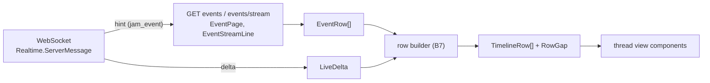

# Thread events (`src/data/events`)

Effect Schema definitions for everything Capy's thread view consumes: the stored event stream, the live deltas for the open turn, the realtime WebSocket frames, and the timeline rows the chat list renders. Every schema is decoded from Capy's production bundle (the `events` HttpApi group and its `EventRow` union, the `LLM.Delta` / `LLM.Event` unions, `Realtime.ServerMessage`, and the transcript row builder). A3's HttpApi client imports these schemas rather than redefining them.

```ts
import {
  EventRow,
  EventStreamLine,
  LiveDelta,
  TimelineRow,
  makeThreadFixtures,
} from "@/data/events";
```

## Layers



| File             | What it holds                                                                                                                               |
| ---------------- | ------------------------------------------------------------------------------------------------------------------------------------------- |
| `ids.ts`         | Branded ids (`Core.EventId` is a 26-char ULID; `JamId`, `ToolCallId`, ...)                                                                  |
| `common.ts`      | `Actor`, `Origin`, `FileRef`, `Mention`, `ModelSelection`, `ContentBlock` / `WireContentBlock`, `AssistantBlock`, `EventState`              |
| `payloads.ts`    | One payload schema per event kind, plus `NOTIFICATION_KEYS` and the nine `ThreadContext` shapes                                             |
| `events.ts`      | `EventRow` (16 kinds + unsupported), `EventPage`, `EventStreamLine`, `ContextUsage`, `AdmitReceipt`, message versions, `SendMessageRequest` |
| `live.ts`        | `LlmEvent` (20 provider events), `LiveDelta` (10 types + unsupported), `RealtimeClientMessage`, `RealtimeServerMessage`, `CdcHint`          |
| `rows.ts`        | `TimelineRow` (18 row types), activity and marker kinds, `RowGap` (stamps)                                                                  |
| `unsupported.ts` | Capy's forward-compatible catch-all: an unknown tag decodes to `{ [tag]: "unsupported", of }` instead of failing                            |
| `fixtures.ts`    | `makeThreadFixtures()`: deterministic neutral samples for every kind above, in wire (encoded) form                                          |

## Wire protocol

- **History:** `GET /orgs/:orgId/jams/:jamId/events?after&before&limit` returns an `EventPage` with `{ items, cursor, serverNow }`.
- **Stream:** `GET .../events/stream` is `application/x-ndjson`. Each line is an `EventStreamLine`: one `page` line (`serverNow`), then `event` lines, then `end` (`cursor`, `avatarUrls`).
- **Realtime:** the client sends `auth`, then `subscribe` with scopes like `jam:<id>`. The server sends `hint` (a CDC row change; `table: "jam_event"` means new events, so refetch after the cursor), `delta` (`{ jamId, delta: LiveDelta }`), `subscribed` and `pong`. Frames are JSON text, so decode them with `RealtimeServerFrame`.
- **Live deltas** are never stored. `turn-start` / `turn-end` bracket a model turn, `llm-event` wraps the provider's text, reasoning and tool-input stream, `tool-activity` reports `execute` sub-calls, and `upload-progress` / `file-uploaded` / `transfer-progress` drive progress bars. `run-start` / `run-end` bracket the whole run and `compaction-start` opens the compacting marker.
- The events API strips server-only assistant fields (run context, notes, digests, worktree, credential id) and review `rules`. The schemas here match the stripped shape.

## Event kind to row to component to frame

Component names are the kiki names from parity-map §1.4. Frame ids are on Doop canvas `tnKVYw9CeC`. "gap" means no captured frame.

| Stored event kind      | Rows the builder emits                                                                                                                                                                                                                                                                                          |
| ---------------------- | --------------------------------------------------------------------------------------------------------------------------------------------------------------------------------------------------------------------------------------------------------------------------------------------------------------- |
| `message`              | `user-message`; a `marker` (retry) when `retryOf` is set; a pending `queue`/`steer` message shows as a queued chip in the composer                                                                                                                                                                              |
| `control`              | `marker` captain (promote, demote, rename) and compaction (live while pending)                                                                                                                                                                                                                                  |
| `notification`         | `update` notice (most keys); `update` review (`review_completion`); `marker` machine, switch, credits, permission, crew, environment, issues, setup; `error` warning (drive, credits, setup failure); `phone-card` (`phone_attached`)                                                                           |
| `rule`                 | none (agent context only)                                                                                                                                                                                                                                                                                       |
| `review_request`       | `marker` review ("Reviewing push abc1234")                                                                                                                                                                                                                                                                      |
| `task_completion`      | `update` task (subagent report card)                                                                                                                                                                                                                                                                            |
| `thread_completion`    | `update` task with a thread reference (crew report); none when `quiet`                                                                                                                                                                                                                                          |
| `operation_completion` | `update` operation                                                                                                                                                                                                                                                                                              |
| `context`              | `marker` access, archive, takeover, fork/side thread; other contexts render nothing                                                                                                                                                                                                                             |
| `assistant`            | `activity` text, reasoning, tool, fallback, wire; `agent-message` (from `message_user` / `message_agent` tool calls and `interrupted_reply`); `clarify`, `environment-request`, `desktop-request`, `terminal-request`, `feedback-request`, `mcp-setup`, `visual`; `error` (`model_refusal`, `refusal_fallback`) |
| `tool_result`          | none of its own: it settles the matching tool `activity` (`result`, phase done/failed)                                                                                                                                                                                                                          |
| `error`                | `error` (severity warning when retryable)                                                                                                                                                                                                                                                                       |
| `compact`              | `marker` compaction ("Compacted from N tokens")                                                                                                                                                                                                                                                                 |
| `legacy`               | none                                                                                                                                                                                                                                                                                                            |
| `mobile_session`       | `mobile-session`                                                                                                                                                                                                                                                                                                |
| `handoff`              | `marker` handoff / return; `error` warning when it failed or setup failed                                                                                                                                                                                                                                       |
| unsupported kind       | `marker` unsupported                                                                                                                                                                                                                                                                                            |

After the per-event pass, the builder groups each exchange: runs of `activity` and `update` rows fold into a `work-group`, consecutive updates fold into a `cluster`, and a turn that produced PRs, ports or setup changes gets a `summary` card.

| Row type (kind)                                           | Component                                                                      | Frames                                                                                                                                                         |
| --------------------------------------------------------- | ------------------------------------------------------------------------------ | -------------------------------------------------------------------------------------------------------------------------------------------------------------- |
| `user-message`                                            | `user-message`, `message-footer`, `reply-quote`                                | `3PIeUOoVrM`; specs `ecIO2AhHF9` `bR_NS8TMpx` `XbQw-2C9JE` `sDEoilcI2j`; contact `m52IwOIMWE` `7mg_y6nF8E` `M-jzf2QANN`; reply quote `oL0fiNW4Lv` `vgcBmoiQqq` |
| `agent-message`                                           | `agent-message`, `message-footer` (streaming while its event is the live turn) | same as above; actions `i379JDis6I`…`l4MxlUIVPD`                                                                                                               |
| `activity` text / reasoning / tool / fallback / wire      | `activity-line`, `activity-row`, `timeline-row`, `tool-body`, `shimmer-text`   | page 10 longwork `u-gkuQ3dXR`…`I7A5QGeIqS`, visuals `BPuDYRLVyV`…`xukZpdLslA`                                                                                  |
| `work-group`                                              | `work-group`, `activity-pill`, `live-status`, `progress-edge`                  | page 10 sets above; contacts `VbCj1uxWFN`…`W9TrbCWI5W`, `brbrga7sA4`…`ZEaWjftFn2`                                                                              |
| `cluster`                                                 | `cluster-row`                                                                  | transcripts (page 11)                                                                                                                                          |
| `marker` (21 kinds)                                       | dividers (`marker`), `waiting-marker`                                          | `UITzoMhMKk`; transcripts                                                                                                                                      |
| `update` notice / review / operation                      | `update-row`                                                                   | transcripts `JTlbjokO_-`, `gVR5Dv4EXd`                                                                                                                         |
| `update` task                                             | task report card (`update-row` report variant)                                 | captain thread `IdF6B_VU2R`                                                                                                                                    |
| `error`                                                   | `error-row`                                                                    | gap                                                                                                                                                            |
| `summary`                                                 | `summary-card`, `pull-ref-link`                                                | chat cards `nUeH23XrzO` `e7VRYgyjZi`                                                                                                                           |
| `visual`                                                  | `visual`                                                                       | `xL7IIVzPiN`, `LykaDhzjbd`                                                                                                                                     |
| `clarify`                                                 | `clarify-takeover`                                                             | `k_vMRAQnSu` (+7), `Cv8nxKizmS`                                                                                                                                |
| `environment-request`                                     | `request-takeover`, `variable-row`                                             | `xuItmh4KnR` (+7)                                                                                                                                              |
| `mcp-setup`                                               | `mcp-setup-card` / `mcp-setup-line`                                            | `8VKRawkVnT`                                                                                                                                                   |
| `desktop-request`, `terminal-request`, `feedback-request` | no timeline row (rendered as composer takeovers)                               | gap                                                                                                                                                            |
| `phone-card`                                              | `phone-card`                                                                   | gap                                                                                                                                                            |
| `mobile-session`                                          | mobile session row                                                             | gap                                                                                                                                                            |
| `RowGap` stamp                                            | `chat-stamp` (`data-slot="chat-stamp"`)                                        | transcripts (page 11)                                                                                                                                          |
| `LiveDelta`                                               | shimmer, forming tool calls, upload bars, `live-status`                        | page 10 sets                                                                                                                                                   |
| `ContextUsage`                                            | `context-meter`                                                                | composer frames (B4)                                                                                                                                           |

## Judgement calls

- **Rows are schemas, not wire types.** Capy's rows are plain TypeScript objects built on the client. They're written as Schemas here so fixtures and mocks can be validated. Deeply derived fields (`chunks`, `proposal`, `placed`, `uploads`, notice detail objects) are `Schema.Unknown` until B7/B8 port the builder.
- **Automation webhook-batch and Linear-facts triggers** are typed loosely (`Unknown` for nested batch and facts) because they only feed the context marker.
- **`LlmEvent` `media.data`** is a `Uint8Array` in Capy; on the JSON wire it's a base64 string, and the schema keeps it as a string.
- **`ClientFeatures`** stays `string[]`; Capy filters it to its known flags on decode.
- The stamp gap threshold lives in a shared chunk constant that isn't decoded yet. B7 should read it from the bundle.
